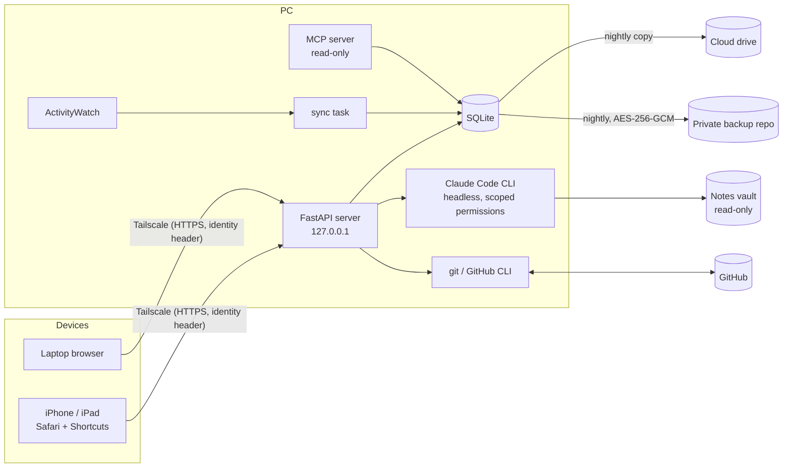

# Personal Dashboard

A self-hosted personal dashboard that pulls my everyday data into one place (PC activity,
iPhone health data, study notes, tasks, focus time, exams and spending) and lets Claude work
with it. It runs on my Windows PC and is reachable only from my own devices through
[Tailscale](https://tailscale.com).

Built with FastAPI + SQLite and a framework-free JavaScript front end; about 9,000 lines of code.

## Features

**Data in one place**
- **PC activity** from [ActivityWatch](https://activitywatch.net): active time per day and per app, with daily rollups and 90-day raw retention.
- **Steps and sleep** from Apple Health, sent by iPhone Shortcuts automations (with a 7-day catch-up when the PC was asleep).
- **Docs stats** for my LaTeX / Typst report repos and Obsidian notes (via the GitHub CLI).

**Study**
- **Workspaces** (NotebookLM-style), one per class: sources (PDF, Markdown, web pages, YouTube transcripts, files from GitHub) and live, read-only links to my notes folders, plus a chat with **Claude Code running headless** on the PC. Per-workspace model choice (Sonnet / Opus / Haiku).
- **Studio** generates study guides, briefings, glossaries, flashcards, quizzes and study plans as structured output, with in-app viewers.
- **Focus sessions** (a server-side timer that works across devices) and **exams** with countdowns, prep time and results.

**Getting things done**
- **Tasks** in the style of Linear: statuses, priorities, labels, projects, sub-issues, activity log, list and board views, keyboard shortcuts, and **recurring tasks** with date ranges.
- Claude **suggests** tasks (as a checklist you approve); it never writes them on its own.
- **Money log**: accounts, categories, transfers, balance corrections, a monthly budget, charts.

**Notes and search**
- **Notes reader** for an Obsidian vault: wiki links, embeds, callouts, math (KaTeX), backlinks; PDFs rendered with PDF.js (every page, also on iPad).
- **Search across everything** (notes, tasks, chats, study material, exams, money) in ~0.1 s, with Japanese support.
- **Quick capture**: type once, save as a task, a money entry (`680 food lunch` is parsed) or a note.
- **Git sync** for the notes repos from any device: fast-forward pull, commit & push, auto-pull, and an optional Claude Code skill run after a pull (handwriting transcription), all with conflict-safe rules.

**For Claude**
- A read-only **MCP server** exposing summaries of all the data to Claude apps (activity, sleep, docs, tasks, focus, money).

## Architecture

- **No API keys for AI.** Claude features run the local Claude Code CLI (`claude -p`) under my own subscription, with `--allowedTools` / `--disallowedTools` scoping what each run may do (e.g. read-only access to linked folders, writes only to an `outputs/` folder).
- **Single-user auth.** Requests come through `tailscale serve`, which adds the user's identity header; only allowed logins get in. Scripts and Shortcuts use a bearer token. The server itself listens on localhost only.
- **Human in the loop.** Claude proposes; anything that changes tasks, pushes code or deletes files needs an explicit click.

## Engineering notes

A few problems that were fun to solve:
- **Scoped headless agents.** Each Claude Code run gets exactly the tools it needs. Lessons learned: a run can't write under `.claude/`, denying `Edit` also blocks `Write`, and a chained shell command is allowed only if every part is.
- **Fast full-text search** over ~15 MB of notes: cached case-folded text per file, invalidated by modification time, and snippets cut from a small window around the first hit (10–80× faster than the naive version).
- **Safe git sync from a phone.** Pull is fast-forward only, keeps unrelated uncommitted edits (autostash), and refuses when the same file changed on both sides; push rebases and aborts on conflicts. Tested against a sandbox "PC" and "iPad" clone pair.
- **Encrypted backups.** Daily SQLite backups are gzipped and encrypted with AES-256-GCM before upload to a private GitHub repo as release files (no history bloat), with a tested restore command.
- **Works on phones and tablets.** A bottom tab bar with pinned sections plus a "More" sheet, an installable web app (manifest + icons), tap-to-read chart values, and PDF.js for multi-page PDFs on iPad.

## Tech stack

Python 3.13 · FastAPI · Uvicorn · SQLite (WAL) · httpx · MCP Python SDK · `cryptography` ·
vanilla JavaScript / CSS (no build step) · KaTeX · PDF.js · Claude Code CLI · GitHub CLI ·
ActivityWatch · Tailscale · iOS Shortcuts

## Project layout

| File | What it does |
|---|---|
| `main.py` | App, auth, ingest endpoints (events, steps, sleep), summaries, middleware |
| `db.py` | Schema and migrations |
| `workspaces.py`, `studio.py` | Workspaces, sources, Claude chat (streaming), Studio jobs |
| `tasks.py`, `focus.py`, `money.py` | Tasks + recurring tasks, focus sessions + exams, money log |
| `notes.py`, `gitsync.py` | Notes reader, search, quick capture; git sync + Claude skill runs |
| `mcp_server.py` | Read-only MCP server for Claude apps |
| `sync_aw.py`, `maintenance.py`, `backup_github.py` | ActivityWatch sync, rollups/retention/backups, encrypted backups |
| `static/` | The single-page front end (`app.js`, `tasks.js`, `focus.js`, `money.js`, `notes.js`, `nav.js`) |

## Running it

1. Python 3.13: `python -m venv .venv`, then `.venv\Scripts\pip install -r requirements.txt`.
2. Copy `config.example.json` to `config.json` and fill in your Tailscale login, repos and folders.
3. Start the server with `pythonw start_server.pyw` (it restarts itself when code changes), then
   expose it with `tailscale serve --bg 8000`.
4. Optional: ActivityWatch, the Claude Code CLI (logged in), the GitHub CLI, and iPhone Shortcuts
   for Health data.

This is a personal project, built around my own setup, not a packaged product.

## License

MIT for my code. `static/vendor/` contains KaTeX (MIT) and PDF.js (Apache-2.0) under their own licenses.
